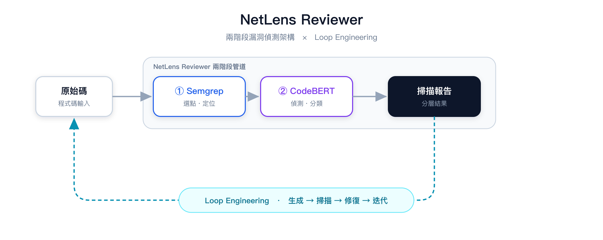
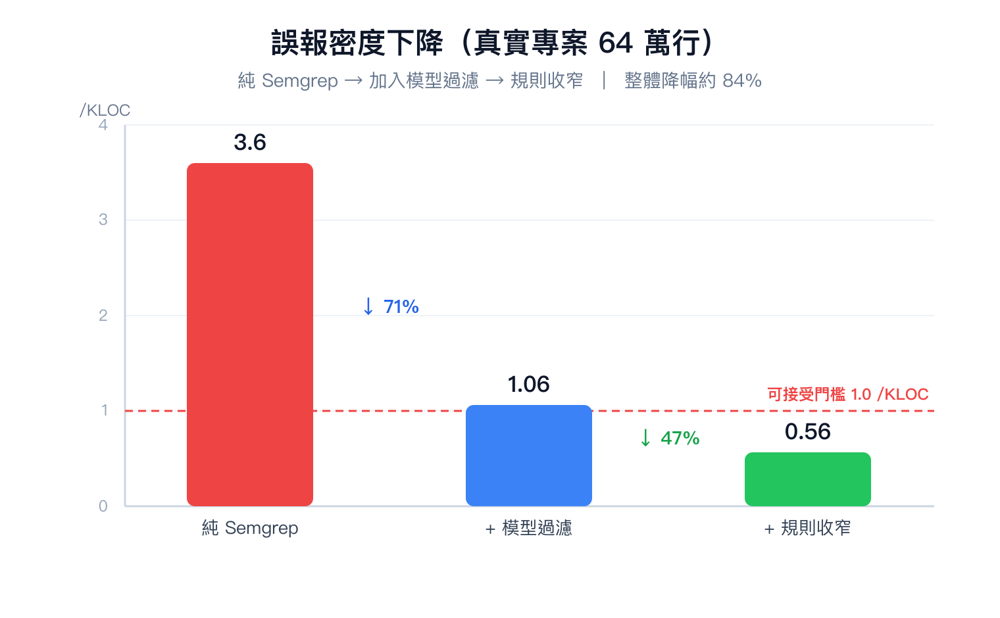
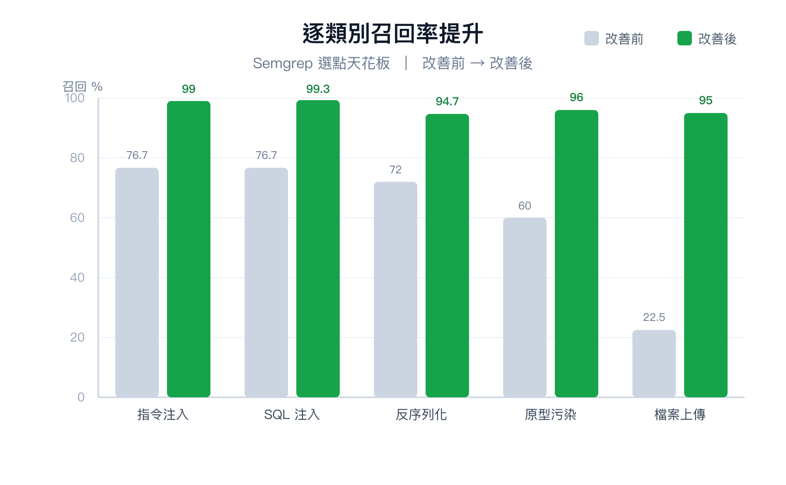

# 🔍 NetLens — On-Prem AI Security Gateway on Intel

> 企業內部署的 AI 資安閘道：找出私有原始碼中的真實漏洞，**原始碼完全不離開內網**。
> ASUS UGen AI League｜Workplace AI × Thunderstorm（Intel Arc Pro B70）

🎬 **Demo 影片**：https://youtu.be/BQLh9FSQCBY

---

## 要解決的問題

靜態掃描工具會產生大量告警，其中多數是誤報；開發者被淹沒後乾脆不看，真正的漏洞因此漏掉。
AI 能幫忙判斷，但對金融、醫療、製造業而言，把私有原始碼上傳到雲端 AI 並不可行。

NetLens 把整條「偵測 → 判定 → 修復建議」管道放在**一台企業內部的工作站**上完成。

## 運作方式



```
原始碼 ──► ① Semgrep 規則選點（Intel CPU，高召回）
       ──► ② CodeBERT 17 類判定，濾掉誤報（OpenVINO INT8，Intel CPU / GPU）
       ──► ③ 本地 Code LLM 解釋漏洞並產生修補（OpenVINO GenAI INT4，同一張 Intel GPU）
       ──► 掃描報告 + 修補建議
```

- **Semgrep**：自訂規則 + 補強規則，負責「找得全」，並由傳輸層抽出漏洞所在的完整函式。
- **CodeBERT**（microsoft/codebert-base 微調，~125M 參數，17 類 = 16 種 CWE + 正常）：負責「判得準」，
  與 Semgrep 判定一致者列為確認漏洞、判為正常者過濾為誤報。
- **本地 LLM**：對確認的漏洞產生攻擊情境說明與修補 diff，全程不連外。
- 支援語言：Python、JavaScript、PHP、Java。

## 成果

### 偵測品質（10 個開源專案、64 萬行程式碼）



| 指標 | 結果 |
|---|---|
| 誤報密度 | 3.6 → 0.56 alerts/KLOC（−84%；其中模型過濾 −71%） |
| 端到端召回 | 75.3%（Semgrep 選點天花板 88.7%） |
| 降噪誤殺率 | 8.9% |



### 在 Intel 硬體上的部署（OpenVINO）

| 項目 | 結果 |
|---|---|
| INT8 量化後模型大小 | 476 MB → 121 MB（3.9× 小） |
| 量化後準確率（2,742 筆測試函式） | macro-F1 0.7159 → 0.7160（逐類別變化 ≤ ±1.4pp） |
| 端到端判定一致率（PyTorch vs OpenVINO INT8） | 99.3%（274 個 finding 中 272 個相同） |
| Intel CPU 吞吐（同一顆晶片） | PyTorch 3.0 → OpenVINO INT8 11.8 函式/秒（3.9×） |
| Intel 內顯延遲 | 93 ms / 函式 |
| 本地 LLM（Qwen2.5-Coder-3B INT4 @ Intel 內顯） | ~15 tokens/s，0 bytes 上雲 |
| Intel Arc Pro B70（**估算**，367 INT8 TOPS） | ~3–5 ms / 函式；CodeBERT 與 LLM 共用一張 32 GB 卡 |

實測平台：Intel Core 5 210H 筆電。完整方法、數據與重現步驟見
**[reviewer/docs/hardware_openvino_report.md](reviewer/docs/hardware_openvino_report.md)**。

## 快速開始

```bash
pip install -r requirements.txt
cd reviewer

python scan.py path/to/project/                     # PyTorch（預設）
python scan.py path/to/project/ --json --out r.json # 輸出 JSON
python scan.py path/to/project/ --no-model          # 只跑 Semgrep 規則
```

需要已訓練的 CodeBERT 權重 `reviewer/models/codebert_v7v8_safe/`（未隨 repo 公開）。

**在 Intel CPU / GPU 上用 OpenVINO 執行：**

```bash
python scripts/ov/ov_export.py                                     # 匯出 OpenVINO IR + INT8 量化
python scan.py path/to/project/ --backend openvino                 # Intel CPU
python scan.py path/to/project/ --backend openvino --ov-device GPU # Intel GPU
```

## 專案結構

```
reviewer/
├── scan.py                 # 完整掃描管道（Semgrep → CodeBERT → 融合分級）
├── transport_layer.py      # Semgrep 執行、依 CWE 分流、抽取所在函式
├── core/                   # 類別設定、融合邏輯、OpenVINO 推論後端（ov_backend.py）
├── rules/                  # Semgrep 自訂規則
├── config/                 # 漏洞類別定義（vuln_categories.json）
├── training/               # 資料整合與 CodeBERT 訓練
├── eval/                   # 評估腳本
├── scripts/ov/             # OpenVINO 匯出、量化、benchmark、準確率評估、本地 LLM 修復
├── demo_console/           # Demo 影片中的 Command Center 展示介面
└── docs/                   # 架構圖、數據圖、硬體部署報告
```

## 文件

- [硬體部署報告（OpenVINO / Intel）](reviewer/docs/hardware_openvino_report.md)
- [Demo 展示介面與影片製作](reviewer/demo_console/README.md)
- [Semgrep 規則說明](reviewer/rules/README.md)

## 授權

見 [LICENSE](LICENSE)。
